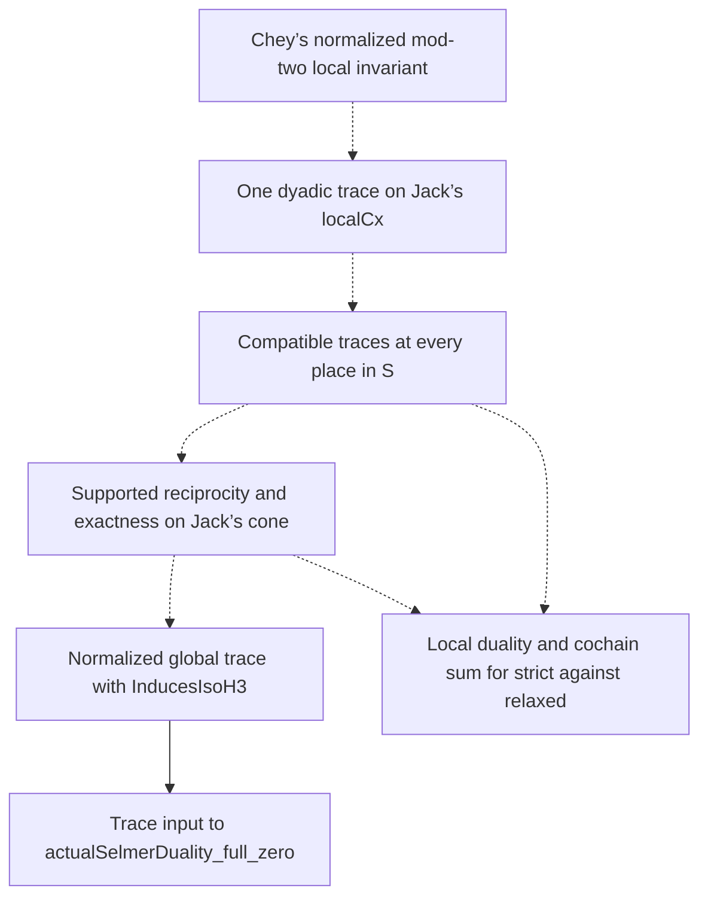

# A first arithmetic trace for Jack’s Theorem 5.3 formalisation

Chey’s proposed contribution is one lemma at a place above two. Chey’s research branch already identifies the mod-two Brauer invariant in its own cochain model. The next theorem would identify that same invariant on the cochains that Jack McCarthy’s Lean development passes to local duality.

## What Jack invited

On 17 November 2026, comments posted at Jack’s request on both of Chey’s open PRs to Glazer’s repository invited Chey to adapt a module to the fork or use it toward an open hypothesis. Jack credited Chey as the import author. Issue #14 was his starting point. The fork’s current ownership table places Theorem 5.3 (`hRC`) with the project on #83. A proposed trace lemma belongs in that discussion as a bounded contribution. [Jack on PR #15](https://github.com/elliotglazer/diophantine-z-q/pull/15#issuecomment-6948048111) · [Jack on PR #27](https://github.com/elliotglazer/diophantine-z-q/pull/27#issuecomment-6948090077) · [Issue #14](https://github.com/Deicyde/diophantine-z-q/issues/14) · [Lane ownership](https://github.com/Deicyde/diophantine-z-q/blob/636c2761c6bc6099cd76b9fb9a515149beec7f6d/docs/one-proof/LANES.md#L29-L38)

| Chey’s contribution | Evidence and present use |
| --- | --- |
| **PR #15** supplies the two raw common-strict cofactor coordinates and an integral-unit criterion for their ratio. | At PR head `8dcb732f`, all 319 added paths match Jack’s `contrib-upstream/pr15/` in path, Git mode and blob. Actual determinant lattices and bases are still needed to apply the criterion. [PR #15](https://github.com/elliotglazer/diophantine-z-q/pull/15) |
| **PR #27** supplies conjugation and continuous $H^1$ transport, together with boundary and homotopy comparisons. | At PR head `fa8eb617`, all 178 added paths match `contrib-upstream/pr27/` on the same checks. The boundary calculations use the specified trace and homotopies. Jack merged both imports in #73 outside the Lean build. [PR #27](https://github.com/elliotglazer/diophantine-z-q/pull/27) · [Import PR](https://github.com/Deicyde/diophantine-z-q/pull/73) · [Import policy](https://github.com/Deicyde/diophantine-z-q/blob/636c2761c6bc6099cd76b9fb9a515149beec7f6d/contrib-upstream/README.md#L7-L15) |
| **Subsequent derivative-switch work** constructs supported localization, the Selmer and compact-support cochains, and a boundary evaluation. It proves terminal rank-reduction lemmas and an outer cofactor bound under their stated hypotheses. | The development receipt covers 32 modules and 53 declarations. Three further modules compiled in development, including the normalized $H^2(F,\mu_2)\simeq\mathbf F_2$ for a characteristic-zero nonarchimedean local field. The final trace gives the sign-line $H^0\times H^2$ pairing. odProof compiled all 309 modules and matched 8,796 declarations to the export. The later replay passed three checkers and the strict axiom audit. Three checkers stopped under memory pressure. Full replay and independent statement comparison remain open. [Original run receipts](ODPROOF.json) · [Later replay record](https://github.com/CheyLoveday/odproof/blob/a477db6fdd6346bf4a72f1f52a48eb93297d04a5/dev/replay-scope-diagnostics-20261118/D0-readback.md) · [Development receipt](https://github.com/CheyLoveday/diophantine-z-q/blob/515cf1421e68150adf4104f9cf1e1dbfd2e5a5c2/research/derivative-switch-arithmetic-lean/RESULT.json) · [Local invariant](https://github.com/CheyLoveday/diophantine-z-q/blob/515cf1421e68150adf4104f9cf1e1dbfd2e5a5c2/lean/Research/DerivativeSwitch/LocalInvariantTwo.lean#L140-L160) · [Local trace](https://github.com/CheyLoveday/diophantine-z-q/blob/515cf1421e68150adf4104f9cf1e1dbfd2e5a5c2/lean/Research/DerivativeSwitch/LocalTraceTwo.lean#L90-L137) |

The original PRs retain historical six-checker results for 39 theorem targets in #15 and 41 roots in #27 (39 theorems and two homotopy-valued definitions). Each PR records its later retained-comparator replay as pending. Chey separately requested a protected review from Glazer on #27. [PR #15 verification](https://github.com/elliotglazer/diophantine-z-q/pull/15) · [PR #27 verification](https://github.com/elliotglazer/diophantine-z-q/pull/27) · [Chey’s request](https://github.com/elliotglazer/diophantine-z-q/pull/27#issuecomment-6771075743)

Jack’s contributors file also credits Chey’s abscissa-parity proof step in the blueprint. That contribution landed separately in #88. [Project credit](https://github.com/Deicyde/diophantine-z-q/blob/636c2761c6bc6099cd76b9fb9a515149beec7f6d/CONTRIBUTORS.md#L27) · [Blueprint PR](https://github.com/Deicyde/diophantine-z-q/pull/88)

## First proposed theorem

Fix a dyadic place $v$ in the support $S$ of the auxiliary totally complex number field $K$. Work at $A_1=(\mathbf Z/2)[t]/(t)$. Use Jack’s `localCx` for the restriction through `locMap` of his cyclotomic line `Tate1 (Acoef 1) hμ`. Identify $A_1$ with $\mathbf F_2$ and the restricted line with $\mu_2$ via $a\mapsto(-1)^a$. His `contH2AddEquiv_homologyπ` already gives the explicit cocycle representing a class. This lets the local comparison start on the completion $K_v$ before comparing the two global Galois quotients. [Local complex](https://github.com/Deicyde/diophantine-z-q/blob/492bcff8bd0d0a385c64f17f392590db7f3ebf0d/ZInQKernel/Contrib/OneProof/RC/SelmerComplex/Selmer.lean#L274-L285) · [Cyclotomic line](https://github.com/Deicyde/diophantine-z-q/blob/492bcff8bd0d0a385c64f17f392590db7f3ebf0d/ZInQKernel/Contrib/OneProof/RC/CoefModules/Cyclotomic.lean#L170-L185) · [Cocycle comparison](https://github.com/Deicyde/diophantine-z-q/blob/492bcff8bd0d0a385c64f17f392590db7f3ebf0d/ZInQKernel/Contrib/OneProof/RC/SelmerComplex/TauCetiComparison.lean#L483-L507)

One reviewable module should produce a linear trace on degree-two cochains of this `localCx` and establish all three properties.

1. It kills degree-two coboundaries.
2. On **every cocycle**, its value agrees with the normalized Brauer invariant under the coefficient and cochain identifications. The Brauer class of invariant $1/2$ evaluates to $1$.
3. It supplies Jack’s literal `InducesIsoH2 trv`. A trace-zero cocycle has a degree-one primitive, and some cocycle has trace one.

The acceptance check is an odProof build of the module against the selected fork revision, an axiom report, and a Lean application passing its outputs into the local trace arguments at $v$. A single place supplies one component of `orthogonal_strict_relaxed_of_print`, which quantifies over **every** place in $S$. The nine-target odProof run covers Chey’s research sources. The adapter and consumer application need their own replay. [Local duality inputs](https://github.com/Deicyde/diophantine-z-q/blob/492bcff8bd0d0a385c64f17f392590db7f3ebf0d/ZInQKernel/Contrib/OneProof/RC/SelmerComplex/Prints.lean#L132-L167) · [All-place consumer](https://github.com/Deicyde/diophantine-z-q/blob/492bcff8bd0d0a385c64f17f392590db7f3ebf0d/ZInQKernel/Contrib/OneProof/RC/SelmerComplex/Orthogonality.lean#L359-L380)

## What follows the local theorem

Dashed arrows require the comparisons described here. The solid arrow identifies an existing theorem argument. Jack’s integration branch already defines the actual elliptic coefficient modules, their Weil pairing, Selmer data, and derivative conditions at the switch place. The full-against-zero duality theorem takes the normalized global trace, the printed Nekovář proposition and the torsion hypotheses. [Actual Selmer duality](https://github.com/Deicyde/diophantine-z-q/blob/492bcff8bd0d0a385c64f17f392590db7f3ebf0d/ZInQKernel/Contrib/OneProof/RC/CoefModules/Selmer.lean#L98-L133) · [Actual derivative conditions](https://github.com/Deicyde/diophantine-z-q/blob/492bcff8bd0d0a385c64f17f392590db7f3ebf0d/ZInQKernel/Contrib/CloudB3RC53/GenuineInst/CoefDerivative.lean#L224-L247)

Jack’s branch now also supplies the map from the Λ-adic module to each finite level and the characteristic-zero switching fibre. The finite-level quotient identification carries its Tate-module surjectivity hypothesis. The branch ties the finite plane to unramified classes under a coordinate hypothesis and gives a tame instance over the residual field. These are the existing objects for any later comparison. [Finite level map](https://github.com/Deicyde/diophantine-z-q/blob/492bcff8bd0d0a385c64f17f392590db7f3ebf0d/ZInQKernel/Contrib/OneProof/RC/LambdaCoef/FiniteLevel.lean#L9-L18) · [Characteristic-zero fibre](https://github.com/Deicyde/diophantine-z-q/blob/492bcff8bd0d0a385c64f17f392590db7f3ebf0d/ZInQKernel/Contrib/OneProof/RC/LambdaCoef/Fibre.lean#L5-L19) · [Unramified finite plane](https://github.com/Deicyde/diophantine-z-q/blob/492bcff8bd0d0a385c64f17f392590db7f3ebf0d/ZInQKernel/Contrib/CloudB3RC53/Hsw/ShapeDerivTie.lean#L8-L32)

- **Global trace.** Extend the comparison over the full finite support, account for places outside it and identify localization and the cone differential. Our cone index 2 is Jack’s compact-support degree 3. Prove supported reciprocity, exactness on trace-zero cocycles and existence of a trace-one class for this trace. Jack already states abstract trace existence in `NekovarProp541`. The added content is its arithmetic normalization. Our current normalization prescribes values on local **cycles**. Jack’s reverse orthogonality theorem asks for the sum formula on **all local cochains**. One route is to take the local extensions by restricting the global trace to each summand and then use linearity. [Our normalization](https://github.com/CheyLoveday/diophantine-z-q/blob/515cf1421e68150adf4104f9cf1e1dbfd2e5a5c2/lean/Research/DerivativeSwitch/ContinuousSelmerTrace.lean#L48-L65) · [Global condition](https://github.com/Deicyde/diophantine-z-q/blob/492bcff8bd0d0a385c64f17f392590db7f3ebf0d/ZInQKernel/Contrib/OneProof/RC/SelmerComplex/Prints.lean#L85-L89) · [Printed existence statement](https://github.com/Deicyde/diophantine-z-q/blob/492bcff8bd0d0a385c64f17f392590db7f3ebf0d/ZInQKernel/Contrib/OneProof/RC/SelmerComplex/Prints.lean#L200-L221)
- **Elliptic pairing and switching.** Compare the degree-one cochain cup to Jack’s existing `localTatePairing` on elliptic torsion. This needs Kummer conditions and coefficient transitions. Distinguish the place $v\mid2$ from the auxiliary derivative prime and the height-one prime $\mathfrak p$ of the coefficient ring. At $\mathfrak p\ne(2)$, two is invertible in $\Lambda_{\mathfrak p}$, so there is no ring map to $\mathbf F_2$. The switching fibre requires the field-generic finite-plane equation and its actual localizations. [Elliptic pairing](https://github.com/Deicyde/diophantine-z-q/blob/492bcff8bd0d0a385c64f17f392590db7f3ebf0d/ZInQKernel/Contrib/CloudB3RC53/Duality/LocalKummer.lean#L58-L80) · [Coefficient obstruction](https://github.com/Deicyde/diophantine-z-q/blob/492bcff8bd0d0a385c64f17f392590db7f3ebf0d/ZInQKernel/Contrib/CloudB3RC53/GenuineInst/ConeCoords.lean#L115-L128) · [Field-generic equation](https://github.com/Deicyde/diophantine-z-q/blob/492bcff8bd0d0a385c64f17f392590db7f3ebf0d/ZInQKernel/Contrib/CloudB3RC53/GenuineInst/ConeCoords.lean#L268-L293)
- **Integral stages and outer bound.** The remaining application of #15 and #27 requires the actual classes and paired rows in the original bases, a signed integral unit on each stage comparison, and the same family throughout the outer bound. A unit ratio between two determinants can conceal a common nonunit. Those obligations bear on `eq35`, `prim_regular` and, after support comparison, `common_coordinate`. The project’s round-three review at `06139fc5` also flags `clearing_model` among four fields whose existential witnesses can differ from the manuscript’s objects. The next review asks that each be proved and removed or restated over the intended objects. The project retains responsibility for assembling `RestrictedConverseGenuine`, an open premise of the headline on the reviewed main branch. [Stage maps](https://github.com/Deicyde/diophantine-z-q/blob/492bcff8bd0d0a385c64f17f392590db7f3ebf0d/ZInQKernel/Contrib/CloudB3RC53/StageCone/Comparison.lean#L183-L222) · [Outer bound](https://github.com/Deicyde/diophantine-z-q/blob/492bcff8bd0d0a385c64f17f392590db7f3ebf0d/ZInQKernel/Contrib/CloudB3RC53/SwitchInputs/GenuineOuter.lean#L260-L279) · [Project review](https://github.com/Deicyde/diophantine-z-q/issues/83#issuecomment-6973094881) · [Follow-up on the witnesses](https://github.com/Deicyde/diophantine-z-q/issues/83#issuecomment-6973805155) · [Reduction](https://github.com/Deicyde/diophantine-z-q/blob/492bcff8bd0d0a385c64f17f392590db7f3ebf0d/ZInQKernel/Contrib/OneProof/RC/Wiring/Leaves.lean#L484-L490) · [Main theorem](https://github.com/Deicyde/diophantine-z-q/blob/636c2761c6bc6099cd76b9fb9a515149beec7f6d/ZInQKernel/OneProof/Main.lean#L209-L217)

In a later reply, the maintainers set out how the four conclusion-shaped leaves should be restated over the manuscript’s objects. The local trace proposed here supplies a different argument to `NekovarProp524`. [Maintainers’ reply](https://github.com/Deicyde/diophantine-z-q/issues/83#issuecomment-6974088651)

Source review of 18 November 2026, 09:05 UTC, at Chey’s research head `515cf142`, Jack’s main `636c2761` and Theorem 5.3 integration head `492bcff8`.
